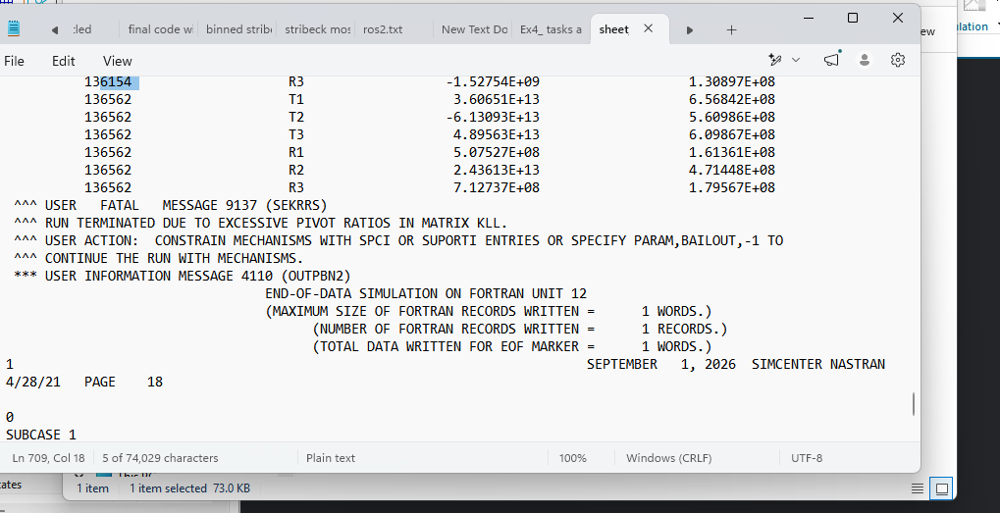
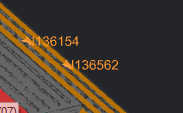
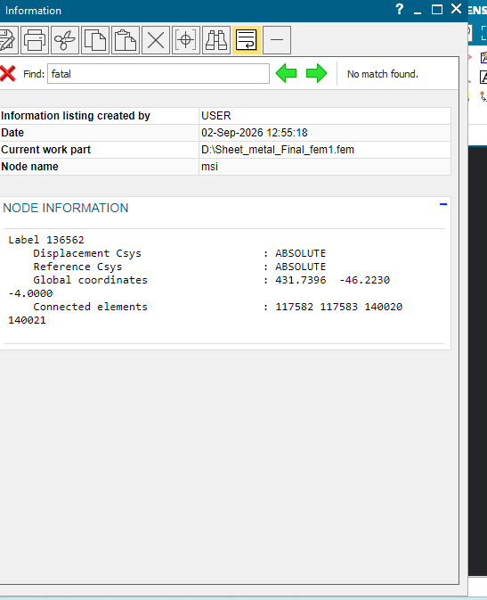
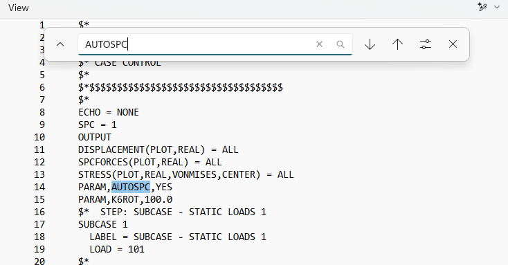
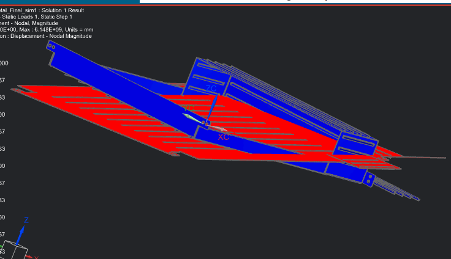
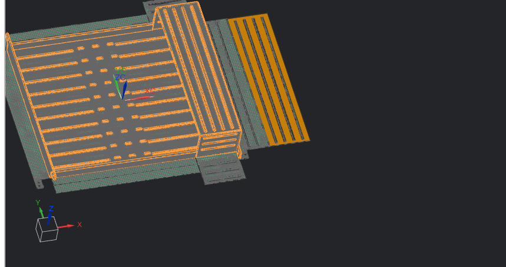
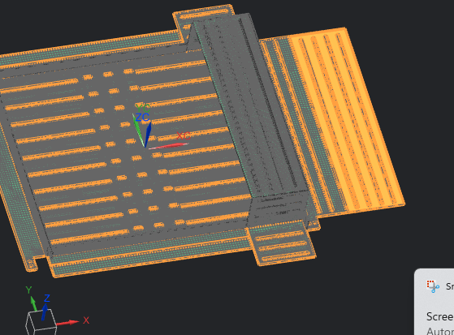

# Sheet Metal Server Rack Shelf — FEM Analysis

FEA simulation of a sheet metal server rack shelf using Siemens NX/Nastran, 
including diagnosing and resolving mesh connectivity and solver singularity 
issues.

## Project Setup

This project involved building and analyzing a finite element model (FEM) of a 
sheet metal server rack shelf in Siemens NX, as part of a manufacturing/DfX 
coursework assignment.

**Model configuration:**
- **Constraints:** 8 fixed constraints representing screw mounting holes 
  (4 on each side of the shelf, matching the cabinet attachment points).
- **Load:** A force representing the server's weight plus a safety factor, 
  applied to simulate the shelf under service conditions.

**Initial issue:** After running the solver, the Results node in the 
Simulation Navigator displayed a status of **"Inferred"** rather than actual 
output — indicating the solve had not produced usable results. This kicked 
off a troubleshooting process to identify and resolve the underlying cause, 
detailed below.

## Troubleshooting Process

### 1. Meshing Warning
Running Model Setup Check flagged: *"Force is applied to geometry that is 
partially meshed or not meshed at all... due to a tiny edge."* The imported 
CAD contained a microscopic sliver edge smaller than the mesh element size, 
so no elements could form there — meaning the load had no valid path into 
the structure.

### 2. Geometry Was Off-Limits
Attempted to fix the tiny edge via Examine Geometry / Idealize Geometry — 
both were unavailable. The imported bodies turned out to be **Polygon 
Bodies** (faceted geometry, not true CAD solids), so standard geometry-repair 
tools didn't apply.

### 3. Workaround: Load Applied to Mesh, Not Geometry
Since the geometry couldn't be edited directly, the force load was deleted 
and recreated by selecting **mesh nodes** instead of a geometry face — this 
sidesteps the unmeshed-geometry problem entirely, since a node-based load 
doesn't depend on the underlying geometry being fully meshed.

### 4. Correcting the Load Physics
Selecting the right nodes required revisiting the original assignment brief, 
which clarified two things:
- The applied force (220.7 N) corresponds to 15 kg × 1.5 safety factor × 
  gravity — the server's weight plus safety margin.
- The ribbed section of the shelf was actually an **air-circulation louver 
  feature**, not a load-bearing surface — the servers don't rest on it.
- The true load points were on the flat floor near the front of the shelf, 
  matching the assignment's reference figure.

  

Two compact node clusters were selected on solid floor material (avoiding 
the perforated louver holes), and the total load was split into two 110.35 N 
forces to represent the two bearing points shown in the assignment figure.

### 5. New Error: Structural Mechanism
With the load corrected, Model Setup Check passed with 0 errors and 0 warnings, 
but the solve failed with a Nastran fatal error:
`USER FATAL MESSAGE 9137 (SEKRRS): RUN TERMINATED DUE TO EXCESSIVE PIVOT RATIOS IN MATRIX KLL`.

This is a different kind of problem from the meshing warning. It means part of 
the structure has no stiffness in some direction (a "mechanism"), so the solver 
cannot compute a unique solution. The Results node stayed on "Inferred" because 
no output file was produced.

### 6. Diagnosing the Singularity
The solver output lists the exact grid points that are unstable. Both flagged 
nodes (136154 and 136562) sat next to each other on the ribbed wall section.

I tested the likely causes one at a time:
- **Orphan node:** node 136562 is connected to 4 elements, so it is not a 
  free-floating node.
- **Duplicate (unmerged) nodes:** the Duplicate Nodes check found none.
- **`PARAM,K6ROT,100.0`:** adds small stiffness for the shell drilling rotation. 
  It did not help, because the flagged node was unstable in all six degrees of 
  freedom, not only one rotation.
- **`PARAM,AUTOSPC,YES`:** automatically constrains near-zero-stiffness DOFs. 
  I confirmed both parameters were written into the solver deck, and the run 
  still failed with the same error. AUTOSPC fixes small numerical singularities, 
  so its failure pointed to a genuine disconnection in the model.

### 7. Root Cause
A forced run (with the solver told to continue past mechanisms) produced 
displacements of about 6 billion mm, and the deformed shape showed the model 
splitting into two pieces that moved apart from each other.

The model is made of two separate Polygon Bodies. They sit next to each other 
geometrically, but their meshes were never connected along the shared boundary, 
so one region was structurally floating relative to the rest.

