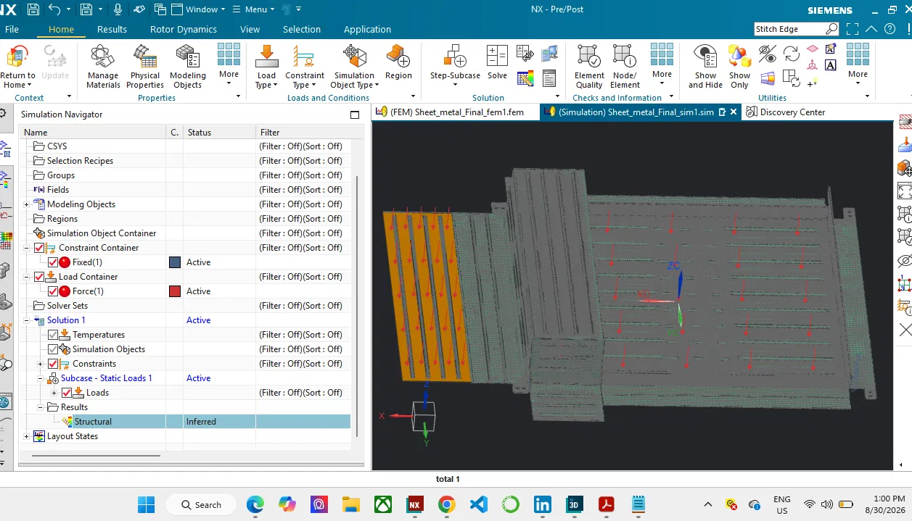
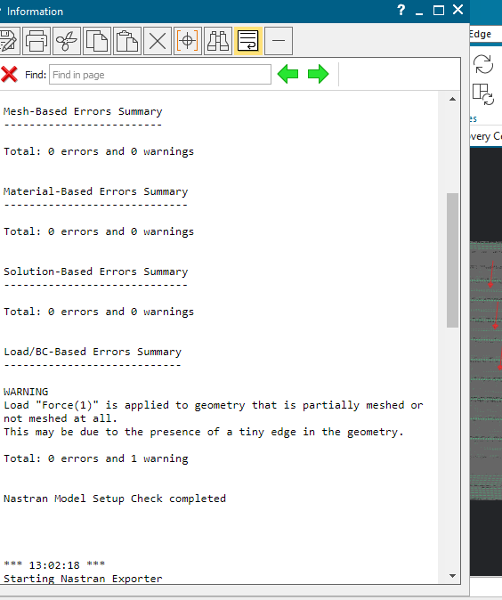
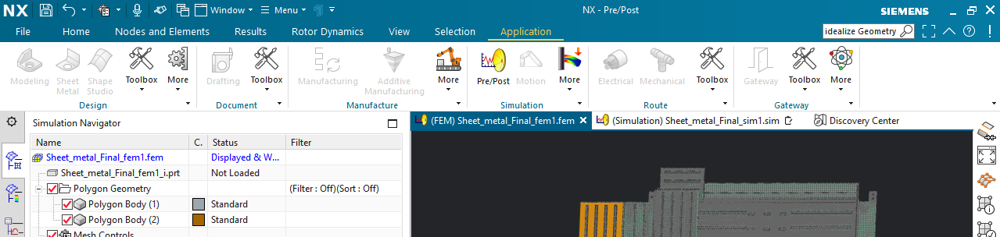

# Sheet Metal Server Rack Shelf — FEM Analysis

FEA simulation of a sheet metal server rack shelf using Siemens NX/Nastran, 
including diagnosing and resolving mesh connectivity and solver singularity 
issues.

## Project Setup

This project involved building and analyzing a finite element model (FEM) of a 
sheet metal server rack shelf in Siemens NX, as part of a manufacturing/DfX 
coursework assignment.

**Model configuration:**
- **Constraints:** 8 fixed constraints representing screw mounting holes 
  (4 on each side of the shelf, matching the cabinet attachment points).
- **Load:** A force representing the server's weight plus a safety factor, 
  applied to simulate the shelf under service conditions.

**Initial issue:** After running the solver, the Results node in the 
Simulation Navigator displayed a status of **"Inferred"** rather than actual 
output — indicating the solve had not produced usable results. This kicked 
off a troubleshooting process to identify and resolve the underlying cause, 
detailed below.

## Troubleshooting Process

### 1. Meshing Warning
Running Model Setup Check flagged: *"Force is applied to geometry that is 
partially meshed or not meshed at all... due to a tiny edge."* The imported 
CAD contained a microscopic sliver edge smaller than the mesh element size, 
so no elements could form there — meaning the load had no valid path into 
the structure.

### 2. Geometry Was Off-Limits
Attempted to fix the tiny edge via Examine Geometry / Idealize Geometry — 
both were unavailable. The imported bodies turned out to be **Polygon 
Bodies** (faceted geometry, not true CAD solids), so standard geometry-repair 
tools didn't apply.

